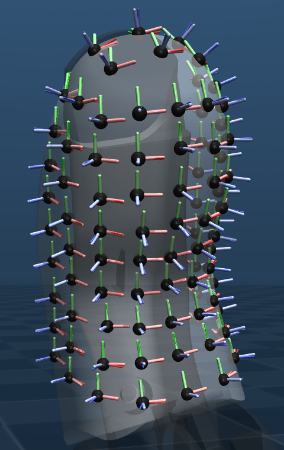
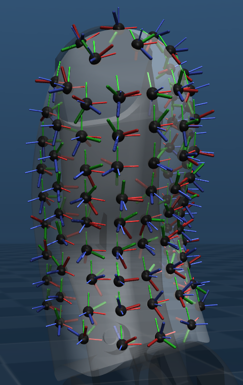
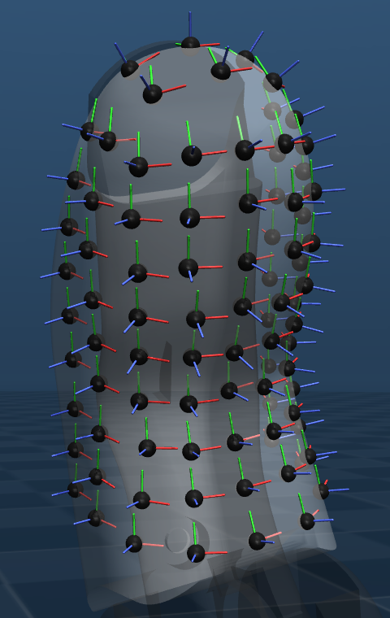
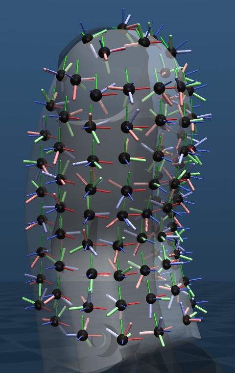
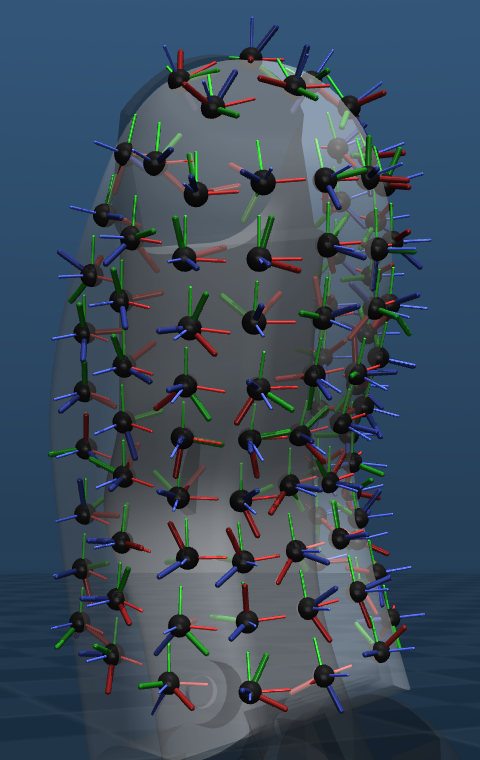
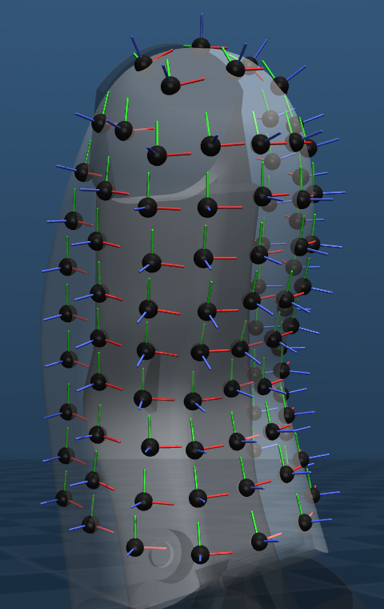

# Testing taxel frame calibration on the Orca hand touch

The only real hand we have access to is an Orca hand touch.

## Methods

Create a recording matching the parameters described in the article (Pan et al. 2026, [arXiv 2605.28812](https://arxiv.org/abs/2605.28812)), then try running the calibration and compare initial and final frames.

We test two types of initial frames:

1. Educated guess: z along the estimated surface normal, x and y as close as possible to the sensor's frame
2. Fully random orientation

The parameters of the recording are the following (`dextHand`, `results/taxel-calibration/calib-data/2026-10-27_10-07-28-index.yaml`):

- Finger: index
- Duration: 2 min at 20 Hz, 2400 samples
- Motion: fingertip pushed in random directions and spots, hand held in a fixed pose
- Motor supply: 12 V, `orca_core` 0.11.0
- Random starting frames: seed 0

## Limitations

The Orca hand touch does not provide joint torques. The only information is actuator current. This allows to approximate joints torque using two simple steps:

- Actuator current to actuator torque: Consider torque to current ratio is a constant for the motor, then we have $\tau_\text{motor} = k_t \, I$ .
  - $I$: motor current, in A.
  - $k_t$: stall torque over stall current of the Dynamixel XC330-T288, 1.14 N·m/A at 12 V ([ROBOTIS e-manual](https://emanual.robotis.com/docs/en/dxl/x/xc330-t288/)).
- Actuator torque to joint torque: motor and joint do the same work, so $\tau_\text{joint} =  \frac{180}{\pi} \, r \, \tau_\text{motor}$ .
  - $r$: joint-to-motor ratio, in motor rad per joint deg, from `orca_core` calibration.

This model does not include: tendon slack and elasticity, friction, etc. What is more, we observe that the true actuator current is highly non-linear.

## Results

The tables below present the mean angle error between the starting or calibrated frames to the real sensor frames.

### Educated guess initial frames

Mean angle between each set of frames and `orca_core`'s taxel axes:

| Angle    | Starting (°) | Calibrated (°) |
| -------- | ------------ | -------------- |
| rotation | 7.6          | 95.4           |
| z axis   | 6.5          | 55.3           |
| x axis   | 6.6          | 79.1           |

|                    Starting                     |                       Calibrated                        |             `orca_core` (true)              |
| :---------------------------------------------: | :-----------------------------------------------------: | :-----------------------------------------: |
|  |  |  |

> Observation: The calibration worsens the orientation compared to simply using the educated guess.

### Random initial frames

Mean angle between each set of frames and `orca_core`'s taxel axes:

| Angle    | Starting (°) | Calibrated (°) |
| -------- | ------------ | -------------- |
| rotation | 134.7        | 108.2          |
| z axis   | 89.3         | 57.6           |
| x axis   | 101.7        | 90.9           |

|                     Starting                      |                        Calibrated                         |              `orca_core` (true)               |
| :-----------------------------------------------: | :-------------------------------------------------------: | :-------------------------------------------: |
|  |  |  |

> Observation: The calibration reduces the angle error, especially along the z axis. The calibrated frames are still way off from the real ones.

## Conclusions

The simplified actuator current to joint torque model used here is insufficient to ensure a good taxel frame calibration.
